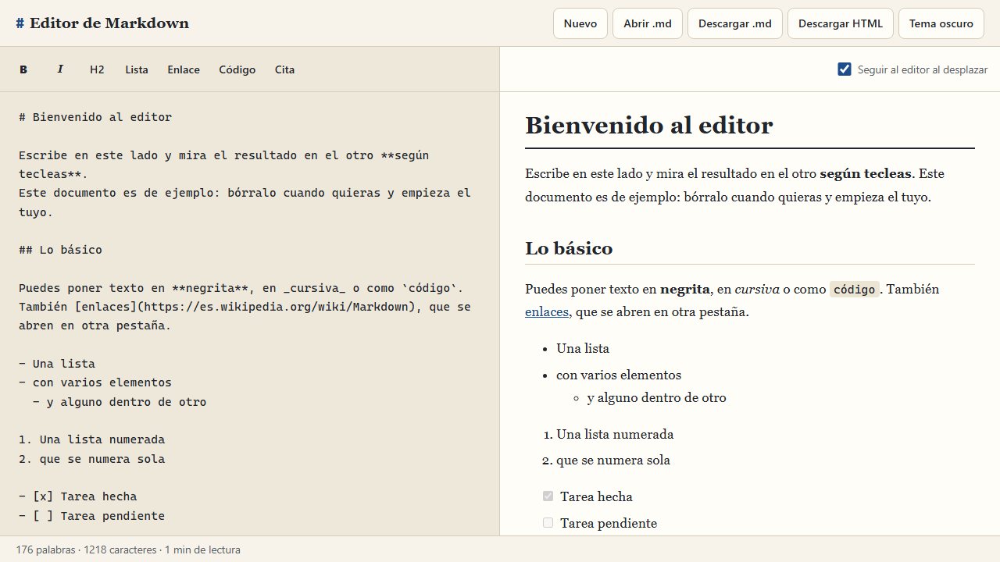

# Editor de Markdown

Un editor de Markdown con **vista previa en vivo**: escribes a un lado y al otro ves el documento ya con formato, según tecleas. Todo se guarda en el navegador; no hay servidor ni cuentas de usuario.

**Demo:** https://danimartin03.github.io/editor-markdown



## Qué hace

- **Dos paneles**, editor y vista previa, que en el móvil pasan a ser dos pestañas.
- **Barra de herramientas**: negrita, cursiva, título, lista, enlace, código y cita. Los botones funcionan como interruptores (volver a pulsar quita el formato) y lo que hacen se puede deshacer con Ctrl+Z.
- **Atajos**: `Ctrl+B` negrita, `Ctrl+I` cursiva, `Ctrl+K` enlace, `Ctrl+E` código y `Ctrl+S` descargar.
- **Contador** de palabras, caracteres y tiempo de lectura.
- **Autoguardado** en `localStorage`.
- **Abrir** un `.md` del ordenador y **descargar** el `.md` o una página HTML completa.
- **Colores en los bloques de código** (HTML, CSS, JavaScript, JSON, Python y Bash).
- La vista previa **sigue al editor** al desplazar (se puede desactivar).
- Tema claro y oscuro, y un documento de ejemplo la primera vez.

## Por qué hay que sanear el HTML

Markdown permite escribir HTML dentro del texto, y la librería que lo convierte (`marked`) lo deja pasar tal cual. Si metiera ese resultado directamente en la página, un documento podría ejecutar código en ella. Por ejemplo:

```html

```

Esa imagen no existe, falla al cargar y el navegador ejecuta lo que hay en `onerror`. Como en este editor se pueden abrir archivos `.md` de otras personas, sería un fallo de seguridad de verdad (se llama XSS): ese código podría leer todo lo que la página guarda.

Por eso el HTML pasa siempre por `DOMPurify`, que quita todo lo que puede ejecutar código (`<script>`, atributos como `onerror`, enlaces `javascript:`…) y deja el formato. En el proyecto hay **una sola función** que convierte y sanea (`convertirMarkdown`, en `js/convertir.js`), y **un solo sitio** donde se mete HTML en la página. Así no se puede saltar el saneado por descuido.

Además de lo que DOMPurify quita por defecto, yo le prohíbo:

- `<style>` y el atributo `style`, para que un documento no pueda cambiar el aspecto del editor ni tapar la página.
- Los formularios y sus campos (menos las casillas de las listas de tareas, que salen desactivadas).
- Las clases CSS (menos la que marca el lenguaje de un bloque de código) y los `id` sin prefijo, para que el documento no choque con los estilos ni con el código de la página.
- Las imágenes que no sean `https`.

Los enlaces se abren en otra pestaña con `rel="noopener noreferrer"`.

## Librerías

Las tres se cargan desde [cdnjs](https://cdnjs.com/) con versión fija y con el atributo `integrity`, que hace que el navegador compruebe que el archivo es exactamente el que yo probé.

| Librería | Versión | Para qué | Licencia |
| --- | --- | --- | --- |
| [marked](https://marked.js.org/) | 18.1.0 | Convertir Markdown en HTML | MIT |
| [DOMPurify](https://github.com/cure53/DOMPurify) | 3.4.16 | Sanear el HTML | Apache 2.0 / MPL 2.0 |
| [highlight.js](https://highlightjs.org/) | 11.11.2 | Colores en los bloques de código | BSD 3-Clause |

Si no cargan (sin conexión, por ejemplo), el editor sigue sirviendo para escribir, guardar y descargar el `.md`. La vista previa enseña un aviso en vez de HTML sin sanear, y sin `highlight.js` el código simplemente sale sin colores.

## Qué he aprendido

<!-- TODO: repasar esta lista y dejarla con mis palabras -->

- Qué es un ataque XSS y por qué no se puede meter en la página HTML que viene de fuera sin limpiarlo antes.
- A dejar una sola puerta de entrada para el HTML, para que sea imposible saltarse el saneado.
- A usar librerías de un CDN de forma más segura: versión fija y `integrity`.
- A trabajar con la selección de un `<textarea>` (`selectionStart`, `selectionEnd`) para envolver texto o añadir prefijos a varias líneas.
- Que cambiar el texto de un `<textarea>` desde código rompe el Ctrl+Z, y cómo evitarlo.
- A separar las funciones que solo trabajan con texto (`texto.js`) de las que tocan la página, y a probarlas con muchos casos. Así encontré dos fallos con el cursor al principio del texto que a mano no habría visto.
- A hacer que una página ocupe justo el alto de la pantalla y que sean los paneles los que se desplazan.
- A no convertir ni guardar a cada tecla, sino un momento después de dejar de escribir.

## Tecnologías

- HTML, CSS y JavaScript sin frameworks ni proceso de compilación.
- `marked`, `DOMPurify` y `highlight.js` por CDN.
- `localStorage` para el autoguardado.

## Privacidad

El texto no sale del navegador. Las únicas peticiones externas de la página son las tres librerías, a cdnjs. Si el documento lleva imágenes por `https`, el navegador las pide al servidor donde estén. En `localStorage` guardo el documento y el tema elegido.

## Cómo ejecutarlo en local

No hace falta instalar nada. Vale con descargar el repositorio y abrir `index.html` en el navegador (con conexión, para que carguen las librerías).

Si prefieres un servidor local, con Python:

```bash
python -m http.server 5540
```

Y después abre http://localhost:5540.

## Estructura

```
index.html          Los dos paneles, la barra y la ventana de confirmar
css/estilos.css     Estilos (móvil primero, tema claro y oscuro)
js/texto.js         Contar palabras y calcular los cambios de la barra (no toca la página)
js/convertir.js     Markdown a HTML saneado, y la página completa para descargar
js/ejemplo.js       El documento de ejemplo
js/app.js           Paneles, barra, atajos, archivos y autoguardado
```

## Límites que conozco

- Un solo documento, guardado en un solo navegador. Para llevarlo a otro sitio hay que descargar el `.md`.
- Abrir un archivo sustituye el documento actual (pide confirmación antes) y el límite es 1 MB.
- El desplazamiento a la par es aproximado: va por proporción, no línea a línea.
- El HTML descargado no lleva los colores del código.
- Sin conexión no hay vista previa, porque las librerías vienen de un CDN.
- El recuento de palabras cuenta trozos separados por espacios, así que no sirve para idiomas que no los usan.

## Mejoras que haría

- Varias notas guardadas, con una lista para cambiar entre ellas.
- Guardar las librerías en el propio repositorio para que funcione sin conexión.
- Desplazamiento a la par exacto, relacionando cada título del editor con el de la vista previa.
- Exportar a PDF.
- Más botones en la barra (tabla, imagen, lista numerada) y pegar imágenes.
- Pruebas automáticas para `texto.js` y para el saneado.

## Licencia

[MIT](LICENSE) © Daniel Martín Pérez
